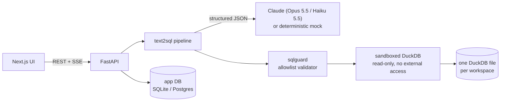

# AskData

**Ask your bank statements questions in plain English and get SQL you can check, a chart, and a one-paragraph answer.** Every query is validated against an allowlist and run in a locked-down DuckDB sandbox. Accuracy is measured on a benchmark checked into this repository.

> Upload UPI and bank exports (CSV, XLSX, SQLite), ask *"How much did I spend each month?"*, and AskData shows the SQL it ran, a monthly chart, and how it defined "spend".

## What it does

- **Messy finance files in, clean tables out.** Ingestion detects Indian date formats (dd/mm vs mm/dd), `₹1,23,456.00` amounts and Dr/Cr columns, then profiles every column.
- **Answers you can check.** Each answer shows the SQL (editable and re-runnable), the assumptions made, any truncation, and the chart the rules picked. A glossary pins down terms like *spend* and *income*.
- **Follow-ups.** You can say "now only food" or "same for 2025" and the conversation carries over.
- **Knows when not to answer.** Ambiguous questions get a clarifying question, and questions the data can't answer say so instead of making something up.
- **Measured accuracy.** 91 benchmark cases, execution-match scoring, ablations, bootstrap confidence intervals, and a CI gate that fails a PR when accuracy regresses.
- **Defence in depth.** A static SQL allowlist and a runtime sandbox, each assuming the other might fail. Per-workspace isolation, rate limits and a daily cost cap.

## Architecture



The question goes into a prompt along with the schema cards, sample values, glossary and history. The model returns `sql`, `clarify` or `unanswerable`. The SQL is validated and executed; on failure it is corrected (at most two retries). The result then gets a rule-based chart and a short explanation. The full walkthrough is in [docs/architecture.md](docs/architecture.md).

## Quickstart

### Without Docker (Python 3.11 + [uv](https://docs.astral.sh/uv/), Node 20+)

```bash
cp .env.example .env            # optional: set ANTHROPIC_API_KEY; without it the mock model is used

cd backend
uv sync
uv run python -m app.demo.seed  # creates the app DB and the demo workspace
uv run uvicorn app.main:app --reload --port 8000

cd ../frontend                  # in a second terminal
npm install
npm run dev                     # http://localhost:3000
```

Open **http://localhost:3000/demo** to try the demo without an account. Create an account to upload your own files.

### With Docker

```bash
export JWT_SECRET=$(python -c "import secrets; print(secrets.token_urlsafe(48))")
export ANTHROPIC_API_KEY=...    # optional
docker compose up --build       # UI on :3000, API on :8000
```

SQLite and the DuckDB files are kept on a named volume. To keep the app DB in Postgres, add `-f docker-compose.postgres.yml`. Platform examples for Fly.io and Render are in [`deploy/`](deploy/).

> The Docker files were written on a machine without Docker. The container's startup command was run locally in prod mode, and the CI `docker` job builds the stack, starts it and asks the demo a question on every push. That job hasn't run yet, because the repo hasn't been pushed. The Postgres override and the platform examples haven't been run at all.

**Deploying the UI and API separately:** put them under one registrable domain (for example `app.example.com` and `api.example.com`) and keep `COOKIE_SAMESITE=lax`. Two platform subdomains such as `*.fly.dev` or `*.onrender.com` count as different sites. That setup needs `SameSite=None; Secure`, which Safari blocks by default, so sign-in there looks like it worked but every request after it fails with a 401.

### Mock mode vs. a real key

Without `ANTHROPIC_API_KEY` the API uses a **deterministic mock model**:
- It answers the suggested demo questions correctly.
- It tells you it's in mock mode for anything else.

The UI, safety checks and charts all still work this way. Set the key for real answers. The defaults are `claude-opus-5-5` for SQL generation and `claude-haiku-5-5` for explanations and descriptions (see `.env.example`).

## Results

| Configuration | Execution accuracy (95% CI) | First-attempt | Clarify/unanswerable | Median latency | Cost / question |
|---|---|---|---|---|---|
| full (production) | *pending keyed run* | — | — | — | — |
| schema_only → +samples → +linking → +glossary → +self_correction → +few_shot | *pending keyed run* | — | — | — | — |

These numbers need a real model run, which hasn't been done yet. To produce them:

```bash
cd backend
uv run python -m app.eval.run --configs schema_only,+samples,+linking,+glossary,+self_correction,+few_shot,full --repeats 3
uv run python -m app.eval.run --baseline ../eval_data/baseline.json --update-baseline   # turns on the CI regression gate
```

The scoring rules, the dataset breakdown (29 easy, 48 medium and 14 hard cases, including 6 clarify and 6 unanswerable) and the known limitations are in [docs/evaluation.md](docs/evaluation.md).

> **About the oracle run in CI:** `--provider oracle` replays the gold answers with failures injected on purpose, so the harness's expected metrics are known exactly. It tests the scorer, not the model, and its numbers are **not** accuracy.

## Security model

- **SQL allowlist (`sqlguard`).**
  - Only a single `SELECT`, set operation or `WITH` statement is allowed.
  - Tables and columns must belong to the workspace, and functions must be on an allowlist.
  - Table functions such as `read_csv` and unbounded cross joins are rejected.
  - The SQL that runs is regenerated from the validated parse tree with a row cap applied.
- **Sandbox.** DuckDB runs `read_only` with external access off, extension autoload and auto-install off, and Python replacement scans off. Memory and thread limits are set, the configuration is then locked, and a watchdog enforces the timeout.
- **Tenancy.** Each workspace has its own DuckDB file. Every route checks membership, and other people's workspaces return 404, so ids can't be probed. The demo workspace is public and read-only, and demo history is private to each user.
- **Auth and limits.**
  - Passwords are hashed with argon2id.
  - Sessions use an httpOnly JWT cookie, and the app refuses to start in prod without a real `JWT_SECRET`.
  - Each caller is limited to 30 requests per minute and $1 of model usage per day. Login attempts are throttled.
  - `X-Forwarded-For` is trusted only when `TRUSTED_PROXY_HOPS` is set.
- **Tests.** 338 tests in total. The 149 in `tests/security/` cover injection, multiple statements, DDL and DML, file and network access, cross-workspace access, resource limits, auth, and hypothesis fuzzing.
- **CI.** Every build runs this suite plus `pip-audit`, `npm audit` and gitleaks.

Design decisions and trade-offs are recorded in [docs/decisions.md](docs/decisions.md) (D-001 to D-021).

## Data handling and retention

- **What's stored:**
  - Raw uploads, plus the DuckDB tables built from them.
  - Questions, generated SQL and run metadata (in `query_runs`).
  - Feedback and saved queries.

  All of it stays until you delete it.
- **Deleting:**
  - Deleting a source removes its raw file and its tables.
  - Deleting a workspace removes its DuckDB file, its uploads and all of its history.
- **What leaves the server:** with a real key, the model provider receives the question, recent conversation turns, the schema, the glossary and **a few sample values per column**. Don't upload data you aren't comfortable sharing with the provider under its data-use terms. Mock mode sends nothing.
- **Logs:** they record request ids, statuses, durations, costs and a hash of the SQL. They contain no result rows and no question text.

## Limitations

- **Synthetic data.** The demo data and the benchmark are synthetic Indian personal-finance data, so accuracy on real, messier exports may be lower. A public-benchmark subset (Spider/BIRD) is on the backlog.
- **Single instance.** Locks, rate limits, the cost tracker and the answer cache live in memory. Scaling out needs Redis and shared storage (see `docs/architecture.md`).
- **Accounts.** There's no account deletion, password reset or OAuth yet.
- **Scope.** Only uploaded files are supported, not live database connections. Charts come from rules rather than the model.

## Repository layout

```
backend/    FastAPI app (app/), Alembic migrations, tests (unit, api, security, eval)
frontend/   Next.js 15 app: landing + demo, ask, data, history, metrics, auth
eval_data/  finance_v1 benchmark (built by build_finance_v1.py), few-shot pool, baseline
docs/       SPEC, PLAN, decisions, architecture, evaluation
deploy/     Fly.io and Render examples
```

## Development

```bash
cd backend && uv run ruff check . && uv run ruff format --check . && uv run mypy app && uv run pytest
cd frontend && npm run lint && npx tsc --noEmit && npm run build
```

Build phases and their status are tracked in [docs/PLAN.md](docs/PLAN.md).

## Still to do (needs accounts or people)

- [ ] Run the benchmark with a real key and commit `eval_data/baseline.json` and the results table above.
- [ ] Deploy to a public URL with the demo workspace.
- [ ] Show the regression gate failing on a real GitHub PR.
- [ ] Record a demo GIF.
- [ ] Get 20 real users, collect their feedback, and note what changed because of it.

## License

[MIT](LICENSE)
