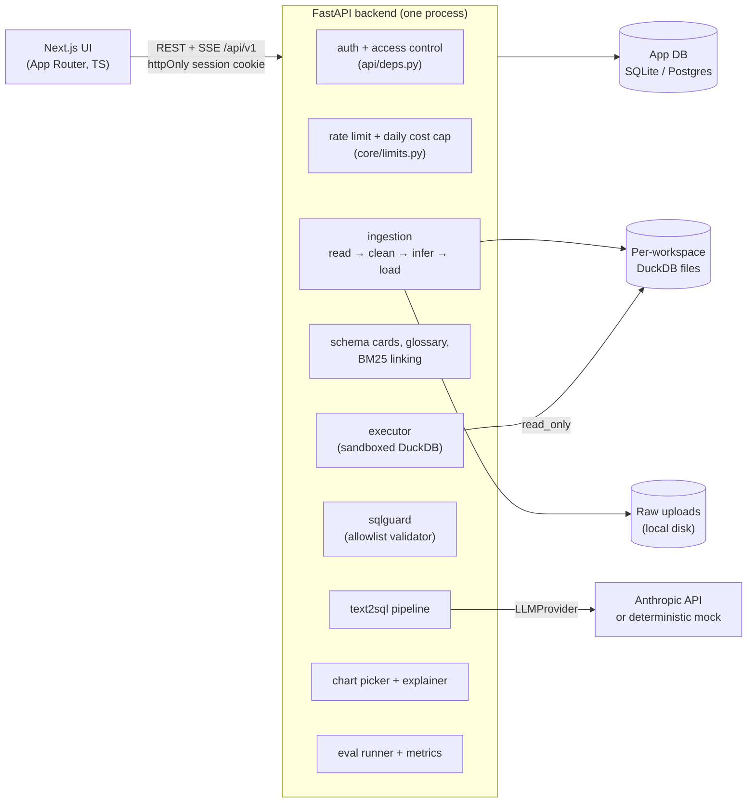

# Architecture

This document explains how a question becomes an answer and where each safety boundary sits. Read [SPEC.md](SPEC.md) for the requirements and [decisions.md](decisions.md) for why things are the way they are.

## Components



| Layer | Code | Notes |
|---|---|---|
| Settings | `backend/app/core/config.py` | Every limit is an env var, and `.env.example` lists them. |
| Auth | `core/security.py`, `api/auth.py`, `api/deps.py` | argon2id hashes, HS256 JWT cookie. Access rules are in D-020. |
| Ingestion | `services/ingestion/` | CSV, XLSX and SQLite inputs. Infers dates (dmy/mdy), currency and Dr/Cr columns. Runs as a background task under the workspace write lock. |
| Schema | `services/schema/` | Builds schema cards (types, samples, stats, join hints) and a fingerprint used for cache keys. BM25 linking applies above 40 columns. |
| Pipeline | `services/text2sql/` | Generate, validate, execute, correct (at most 2 retries), then chart and explain. Answers are cached by (schema fingerprint, question, history). |
| Safety | `services/sqlguard/`, `services/execution/` | Two independent layers. See below. |
| LLM | `services/llm/` | A `complete_json` protocol with Anthropic and mock implementations. Structured outputs are Pydantic models. |
| Eval | `app/eval/`, `eval_data/` | Execution-match scoring, ablations, bootstrap CIs and a CI gate. See [evaluation.md](evaluation.md). |
| UI | `frontend/src/` | Ask (streamed answers, charts, SQL editor), Data (sources, schema, glossary), History, Metrics. |

## Life of a question

```mermaid
sequenceDiagram
    participant U as Browser
    participant A as /ask (SSE)
    participant P as Pipeline
    participant M as LLM
    participant G as sqlguard
    participant X as Executor
    U->>A: question (+ conversation_id)
    A->>A: access check, rate limit, cost cap
    A->>P: run(question, history)
    P->>P: schema cards (+ BM25 linking), glossary, few-shot
    P->>M: generate (strong model, JSON schema)
    M-->>P: {kind: sql | clarify | unanswerable, sql, assumptions}
    loop at most 1 + 2 corrections
        P->>G: validate(sql, allowed tables/columns)
        G-->>P: ok (normalised SQL) or reason
        P->>X: execute (read-only, timeout, row cap)
        X-->>P: rows or error
        P->>M: on error or suspicious empty result: correct with the error message
    end
    P->>P: pick chart (rules)
    P->>M: explain (fast model; deterministic fallback)
    P-->>A: stage events, then the result
    A-->>U: SSE events: status (generating / correcting / checking_empty_result), sql, chart, explanation, done
```

Every run is stored in `query_runs` with the prompt version, model, tokens, cost, attempts, error category and user id. The metrics page aggregates from that table.

## Safety layers

The validator and the sandbox each assume the other might fail.

1. **`sqlguard` (allowlist, static).** The SQL must parse to a single statement whose root is `SELECT`, a set operation or `WITH`.
   - Tables and columns must exist in this workspace's schema.
   - CTEs are resolved with correct scoping.
   - Functions come from an explicit allowlist, and table functions (`read_csv`, `read_parquet`, and similar) are banned.
   - A guard rejects unbounded cross joins.
   - The SQL that gets executed is regenerated from the validated tree with a row cap applied, never the model's original text.
2. **Executor (runtime sandbox).** The DuckDB connection settings are:
   - `read_only`
   - `enable_external_access=false`, with extension autoload and auto-install off
   - `python_enable_replacements=false`
   - memory and thread limits, then `lock_configuration=true`

   A watchdog interrupts queries past the timeout. Each execution writes an audit log line with a hash of the SQL.
3. **Tenancy.** Each workspace is its own DuckDB file at `DATA_DIR/workspaces/<hex id>.duckdb`. Ids are validated as hex before they become paths. Every route checks membership through its workspace (D-020).

The safety suite (`backend/tests/security/`) runs in every CI build. It covers injection, multiple statements, DDL and DML, file and network access, cross-workspace reads, resource exhaustion, auth and tenant isolation, and hypothesis fuzzing. Prompt injection carried in data (instructions hidden in cell values or column names) is covered in `tests/unit/test_pipeline.py`. Those tests check that schema text is escaped inside its prompt tags, and that whatever SQL comes back still has to pass `sqlguard`.

## Concurrency and scaling

- One API process by design. The per-workspace read/write lock, the answer cache, the rate limiter and the cost tracker all live in memory, so Docker and the platform examples pin a single worker and a single machine.
- Readers open DuckDB read-only and never block each other. Ingestion takes the write lock.
- To scale out, move the limiter, cost tracker and cache to Redis and the DuckDB files to a shared volume or object storage. Each of these sits behind a small interface for that reason (D-004).

## Deployment shapes

| Shape | App DB | Files | Status |
|---|---|---|---|
| Local dev (`uv` + `npm`) | SQLite in `./data` | `./data` | Used throughout development |
| `docker compose up` | SQLite on a named volume | Same volume | Not run locally (no Docker); the CI `docker` job builds it and smoke-tests it |
| `+ docker-compose.postgres.yml` | Postgres 17 | Backend volume | Migration renders for Postgres; runtime untested |
| Fly.io / Render (`deploy/`) | SQLite on a mounted disk | Same disk | Examples; cross-site cookies (`SameSite=None; Secure`) |
